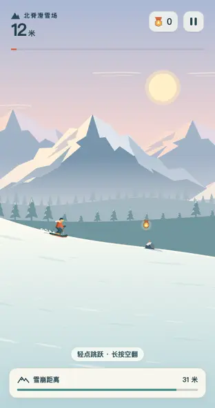

# Indie Game Art · ゲームの画づくり

[English](README.md) · [简体中文](README.zh-CN.md) · **日本語**

**Indie Game Art は、試作中のゲームの仮素材を、実際に操作して試せるキャラクター、背景、ボタン、アニメーションに作り替えるスキルです。**

| こんなときに | 手元で確かめられるもの |
| --- | --- |
| 遊ぶ仕組みはできたけれど、素材はまだ仮のまま。 | 遊べる一場面で絵柄を決めて、仮素材を最初のキャラクター、背景、操作ボタンに置き換えます。実際に遊びながら、絵のまとまりを確かめられます。 |
| 絵はあるけれど、操作画面がウェブページのように見える。 | いちばんよく使う画面から手を入れます。次に何を見てどこを押すかに合わせて情報を配置し、ボタンやアイコン、パネルにゲームの世界で使われている形や質感を取り入れます。 |
| 静止画は気に入っているのに、操作しても手応えが薄い。 | 操作に合わせて動きをつけます。ボタンは押した瞬間に反応し、命中の瞬間には短い間を置き、勝利したら最後のポーズを一拍長く見せます。 |

## 遊べる比較

[ゲームを選ぶ](https://hanszcy.github.io/indie-game-art/play/?lang=ja)

### 箱押しパズル

| [通常版を遊ぶ](https://hanszcy.github.io/indie-game-art/play/sokoban/baseline/) | [Skill 版を遊ぶ](https://hanszcy.github.io/indie-game-art/play/sokoban/skill/) |
| :---: | :---: |
| [](https://hanszcy.github.io/indie-game-art/play/sokoban/baseline/) | [](https://hanszcy.github.io/indie-game-art/play/sokoban/skill/) |

### フードマッチ3

| [通常版を遊ぶ](https://hanszcy.github.io/indie-game-art/play/match/baseline/) | [Skill 版を遊ぶ](https://hanszcy.github.io/indie-game-art/play/match/skill/) |
| :---: | :---: |
| [](https://hanszcy.github.io/indie-game-art/play/match/baseline/) | [](https://hanszcy.github.io/indie-game-art/play/match/skill/) |

### スキーアドベンチャー

| [通常版を遊ぶ](https://hanszcy.github.io/indie-game-art/play/ski/baseline/) | [Skill 版を遊ぶ](https://hanszcy.github.io/indie-game-art/play/ski/skill/) |
| :---: | :---: |
| [](https://hanszcy.github.io/indie-game-art/play/ski/baseline/) | [](https://hanszcy.github.io/indie-game-art/play/ski/skill/) |

## 導入

```sh
npx skills add hanszcy/indie-game-art --skill indie-game-art
```

手動で導入するには、[indie-game-art フォルダー](skills/indie-game-art)をお使いのツールのスキル用ディレクトリにコピーします。入口は [SKILL.md](skills/indie-game-art/SKILL.md) です。
