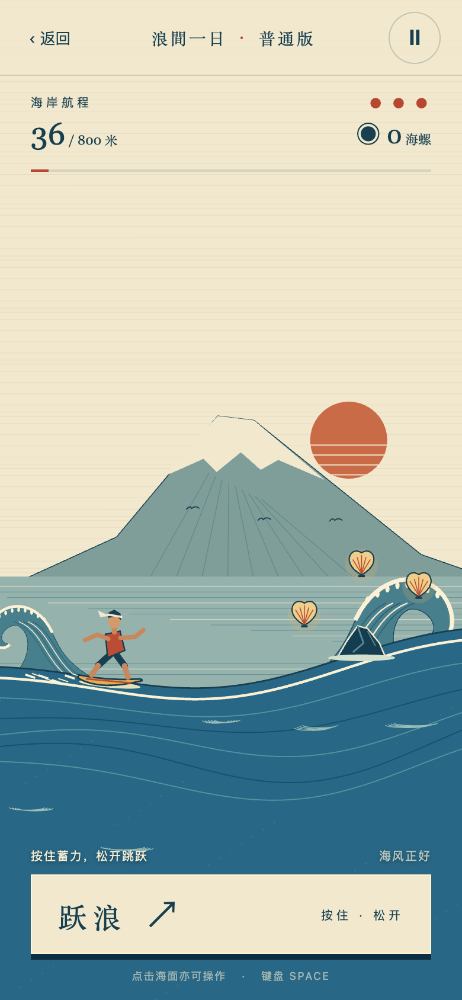
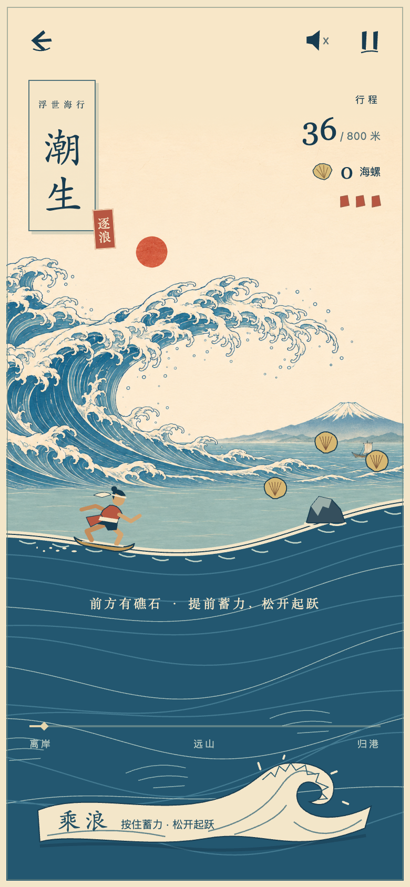
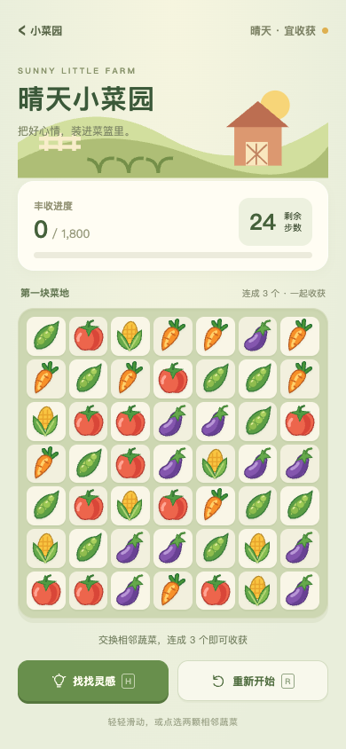
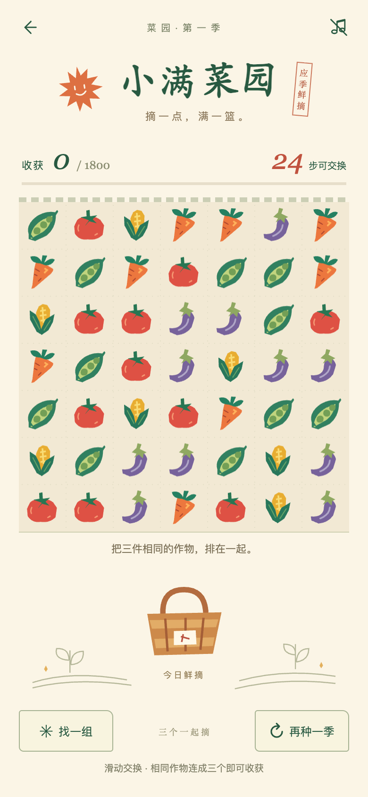

# Indie Game Art · ゲームの画づくり

[English](README.md) · [简体中文](README.zh-CN.md) · **日本語**

Indie Game Art v3 は、実際に遊べる一場面を選び、キャラクターの形、画面に出る言葉、操作したときの動きを磨くスキルです。

## 浮世絵サーフィン · Skill 3.2 比較

[サーフィンの二つのバージョンを遊ぶ](https://hanszcy.github.io/indie-game-art/play/surf/)

| [Skill なし · 浪間の一日](https://hanszcy.github.io/indie-game-art/play/surf/plain/) | [Skill あり · 潮生](https://hanszcy.github.io/indie-game-art/play/surf/skill/) |
| :---: | :---: |
| [](https://hanszcy.github.io/indie-game-art/play/surf/plain/) | [](https://hanszcy.github.io/indie-game-art/play/surf/skill/) |

スマートフォン縦画面の2Dサーフィン。長押しで力をため、離すとジャンプ。両版は同じ800mのコースと物理を使用します。Skill版にはオリジナルの木版画風の海景と、沈み込み・空中・着水の姿勢を加えています。素材制作への投入量が異なるため、厳密な実験ではありません。

## 農園マッチ3 · Skill 3.2 比較

[二つのバージョンを遊ぶ](https://hanszcy.github.io/indie-game-art/play/farm/)

| [Skill なし](https://hanszcy.github.io/indie-game-art/play/farm/plain/) | [Skill あり · 小満菜園](https://hanszcy.github.io/indie-game-art/play/farm/skill/) |
| :---: | :---: |
| [](https://hanszcy.github.io/indie-game-art/play/farm/plain/) | [](https://hanszcy.github.io/indie-game-art/play/farm/skill/) |

スマートフォンの縦画面に対応。初期盤面とルールは同じです。Skill 版では野菜と収穫かごを描き直し、消した野菜がかごに届く動きを加えています。厳密な実験ではなく、遊べるデザイン比較です。

| 遊んでいて気になること | 試せること |
| --- | --- |
| まだ仮素材のまま、または絵に個性が出ない | 同じ場面で同じキャラクターを二通りに描き、プレイ時の大きさで輪郭と姿勢を見比べます。[一羽のサギ、二つの構え](skills/indie-game-art/plates/bird-study.svg) |
| 台詞が硬い、説明がくどい | 台詞と画面の表示を続けて読みます。重なる説明を削り、人物の口調や選択肢が伝わるか確かめます。 |
| 操作画面がウェブページに見える | 画面にある道具を一つ、直接操作できるようにします。見比べたい情報は並べておきます。 |
| どの操作も同じ手応えに感じる | 普段の一手と勝負が決まる一手を比べます。先に動く部位、踏みとどまる足、動きが収まったときの姿勢を変えてみます。 |

## 導入

```sh
npx skills add hanszcy/indie-game-art --skill indie-game-art
```

手動で導入するには、[indie-game-art フォルダー](skills/indie-game-art)をお使いのツールのスキル用ディレクトリにコピーします。[スキル本文](skills/indie-game-art/SKILL.md) · [日本語ガイド](docs/guide.ja.md)
