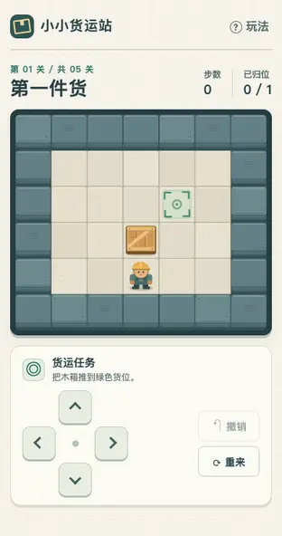
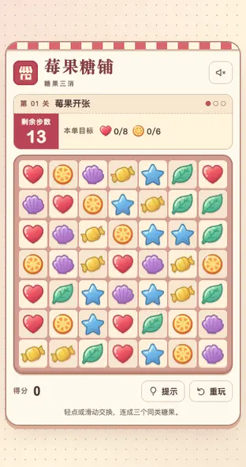

# Indie Game Art

**English** · [简体中文](README.zh-CN.md) · [日本語](README.ja.md)

**Indie Game Art helps indie developers replace placeholder characters, scenery, controls and animations in a playable prototype.**

| What you're stuck on | What you can get |
| --- | --- |
| The mechanics work. The game still uses placeholder art. | Choose a look for one playable scene, then replace its stand-ins with a first set of characters, scenery and controls. See how they fit together in the build. |
| The game has artwork, but its interface still feels like a website. | Rework the screen players use most. Arrange information around what they need to see and do next, then draw buttons, icons and panels using shapes and materials from the game world. |
| The still frames look right, but the game barely reacts to input. | Tie motion to the events players trigger. Let a button respond on contact, give a hit a brief pause, and hold the final pose for an extra beat on a win. |

## Playable comparisons

[Play all three](https://hanszcy.github.io/indie-game-art/play/?lang=en)

### Sokoban

| [Play baseline](https://hanszcy.github.io/indie-game-art/play/sokoban/baseline/) | [Play with Skill](https://hanszcy.github.io/indie-game-art/play/sokoban/skill/) |
| :---: | :---: |
| [](https://hanszcy.github.io/indie-game-art/play/sokoban/baseline/) | [](https://hanszcy.github.io/indie-game-art/play/sokoban/skill/) |

### Food Match-3

| [Play baseline](https://hanszcy.github.io/indie-game-art/play/match/baseline/) | [Play with Skill](https://hanszcy.github.io/indie-game-art/play/match/skill/) |
| :---: | :---: |
| [](https://hanszcy.github.io/indie-game-art/play/match/baseline/) | [](https://hanszcy.github.io/indie-game-art/play/match/skill/) |

### Ski Adventure

| [Play baseline](https://hanszcy.github.io/indie-game-art/play/ski/baseline/) | [Play with Skill](https://hanszcy.github.io/indie-game-art/play/ski/skill/) |
| :---: | :---: |
| [](https://hanszcy.github.io/indie-game-art/play/ski/baseline/) | [](https://hanszcy.github.io/indie-game-art/play/ski/skill/) |

## Install

```sh
npx skills add hanszcy/indie-game-art --skill indie-game-art
```

For manual installation, copy the [indie-game-art folder](skills/indie-game-art) into your tool’s skills directory. The entry point is [SKILL.md](skills/indie-game-art/SKILL.md).
