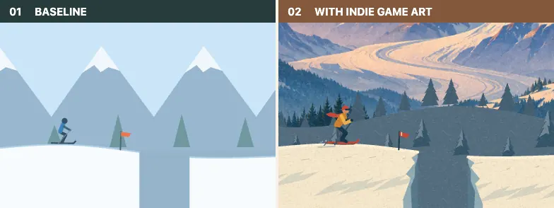
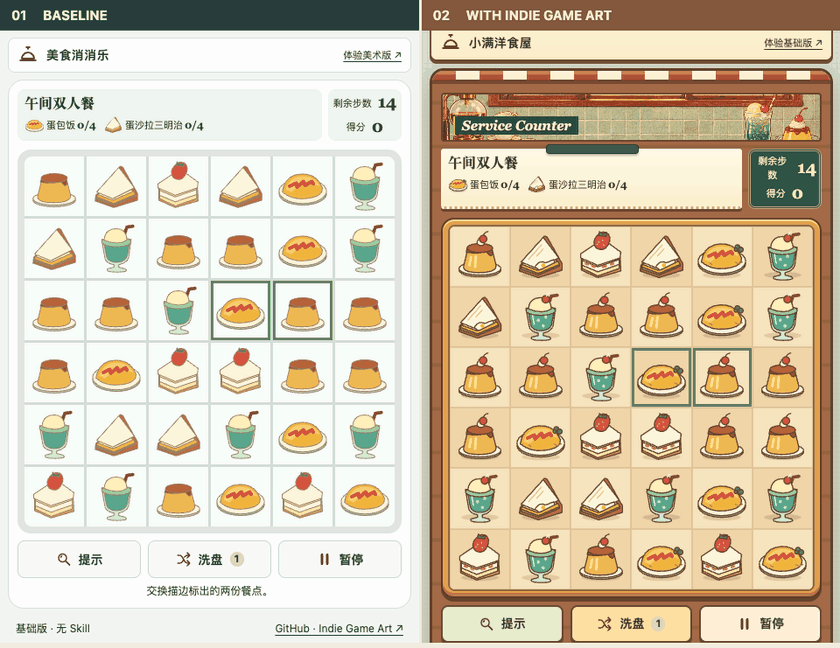

# Indie Game Art

**English** · [简体中文](README.zh-CN.md) · [日本語](README.ja.md)

**Indie Game Art helps indie developers replace placeholder characters, scenery, controls and animations in a playable prototype.** Load the skill in your game project, pick a scene, and describe the mood you want and the rules you want to keep. Start with that scene and play the changes in the build.

| What you're stuck on | What you can get |
| --- | --- |
| The mechanics work, but you haven't settled on a look. | Side-by-side sketches of the same scene. Choose the lighting, colors and character shapes you like, then use the chosen sketch as a guide for the next batch of assets. |
| The buttons look like a website and the characters look pasted onto the background. | A playable scene with the characters, scenery, icons and controls drawn to fit together. Try a button and see how its face changes under your finger and when you release it. |
| A tap changes a number, but it's hard to tell what happened. | An animation wired to the actual input. Replay the same move before and after the edit to see what reacts, when the action takes effect and where the result appears. |

A screenshot is enough to start a review. Mark the most useful changes and compare a redrawn frame with the original. With access to the project source, the chosen treatment can go into the game.

## Playable comparisons

[](https://indie-game-art-biscuits.vercel.app/ski/alpenglow/)

[](https://indie-game-art-biscuits.vercel.app/kissaten/)

## Install

```sh
npx skills add hanszcy/indie-game-art --skill indie-game-art
```

To install manually, copy the repository into your tool’s skills directory as `indie-game-art`. The entry point is [SKILL.md](SKILL.md).

Try this in your game project.

> Use Indie Game Art on the current game screen. Keep the rules and main character. Start with the button that looks most like a web control. Redraw its icon, its pressed state and the feedback when it activates so I can try it in the build.

[Skill guide](SKILL.md) · [Six reference studies](references/research-and-direction.md) · [Visual contract template](assets/visual-contract.md) · [Cat-and-mouse case notes](references/session-lessons.md)
