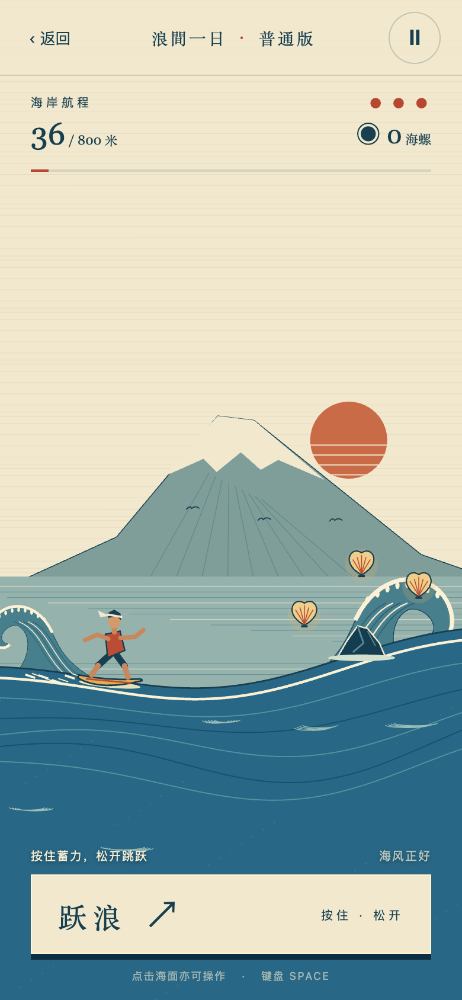

# Indie Game Art

**English** · [简体中文](README.zh-CN.md) · [日本語](README.ja.md)

Indie Game Art v3 works on one playable moment at a time, from the shape of a character to the words and motion that follow an input.

## Ukiyo-e Surfing · Skill 3.1

[Play the two surfing editions](https://hanszcy.github.io/indie-game-art/play/surf/)

| [Without Skill · Between the Waves](https://hanszcy.github.io/indie-game-art/play/surf/plain/) | [With Skill · Tideborn](https://hanszcy.github.io/indie-game-art/play/surf/skill/) |
| :---: | :---: |
| [](https://hanszcy.github.io/indie-game-art/play/surf/plain/) | [](https://hanszcy.github.io/indie-game-art/play/surf/skill/) |

Portrait 2D surfing: hold to charge, release to jump. Both editions use the same 800 m course and physics. The Skill edition adds an original woodblock-style seascape and distinct crouching, airborne and landing poses. Asset effort differs; this is a playable design comparison, not a controlled experiment.

## Farm Match-3 · Skill 3.1

[Play the two editions](https://hanszcy.github.io/indie-game-art/play/farm/)

| [Without Skill](https://hanszcy.github.io/indie-game-art/play/farm/plain/) | [With Skill · Xiaoman Garden](https://hanszcy.github.io/indie-game-art/play/farm/skill/) |
| :---: | :---: |
| [](https://hanszcy.github.io/indie-game-art/play/farm/plain/) | [](https://hanszcy.github.io/indie-game-art/play/farm/skill/) |

Same portrait layout, initial board and rules. The Skill edition redraws the crops and basket, then carries each harvest into the basket. These are playable design comparisons, not a controlled experiment.

| What's wrong in play? | What to try |
| --- | --- |
| The art is temporary or lacks character. | Draw the same character two ways in the same scene. Compare its silhouette and pose at playing size. [Two studies of a heron](skills/indie-game-art/plates/bird-study.svg) |
| The writing feels stiff or repetitive. | Read the dialogue and HUD together. Cut a repeated fact and check that the speaker’s voice and the player’s choices still come through. |
| The controls feel like a webpage. | Move one action onto the object it affects. Keep information side by side when players need to compare it. |
| Every action feels alike. | Compare an ordinary move with the last move of a round. Change what moves first, what stays planted and where the motion comes to rest. |

## Install

```sh
npx skills add hanszcy/indie-game-art --skill indie-game-art
```

For manual installation, copy the [indie-game-art folder](skills/indie-game-art) into your tool’s skills directory. The entry point is [SKILL.md](skills/indie-game-art/SKILL.md).
