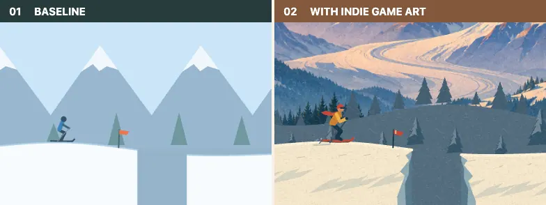

# Indie Game Art · 独立游戏美术

[English](README.md) · **简体中文** · [日本語](README.ja.md)

**Indie Game Art 帮你把游戏原型里的占位图、默认按钮和生硬的动作，改成一套画风一致、能在原项目里试玩的美术和动效。** 在开发工具里启用这个 Skill，给它一幕游戏画面，说明你想要的气氛和要保留的玩法。

| 你遇到的问题 | 你能拿到什么 |
| --- | --- |
| 有玩法，还没想好画风 | 同一场景的几张风格草图。你可以并排挑选喜欢的光线、配色和人物造型，再拿选中的一张指导后续素材。 |
| 游戏能玩，但按钮像网页，角色和背景像两套素材 | 一幕改好、能玩的游戏画面。角色轮廓、场景光照、图标和按钮用同一套画法，按钮按下和松开也有各自的状态。 |
| 玩家点了，画面只跳一个数字，很难看出发生了什么 | 一段接到真实操作上的动画。你可以在同一次输入下，对照修改前后，看清哪个物件动了、动作何时生效、结果落在哪里。 |

只有一张截图也可以开始。先标出画面里最该改的地方，再画一版修改稿与原图并排比较。有了项目源码，就可以把选定的方案接进游戏。

## 实机对照与试玩

| 浏览器试玩 | 未使用 Skill | 使用 Indie Game Art |
| --- | --- | --- |
| 滑雪跳跃 | [玩基础版](https://indie-game-art-biscuits.vercel.app/ski/classic/) | [玩《雪线晨光》](https://indie-game-art-biscuits.vercel.app/ski/alpenglow/) |
| 美食消消乐 | [玩基础版](https://indie-game-art-biscuits.vercel.app/classic/) | [玩《小满洋食屋》](https://indie-game-art-biscuits.vercel.app/kissaten/) |

[打开试玩合集](https://indie-game-art-biscuits.vercel.app/play/?lang=zh) · [安装 Skill](#安装)

### 雪线晨光 · 腾空看姿势，落地看雪板



**自己试一跳。** 按住雪坡或底部按钮蓄力，在红旗旁松手。电脑上可以用空格键。两版共用 782 米雪道、10 道雪沟，以及同一套速度、跳跃弧线和落地判定。上图录的是同一组输入经过第四道雪沟。

**盯住膝盖，再看板尾。** 基础版里，蓝色小人越过浅色山脊。《雪线晨光》用赭黄色外套和红围巾把人从版画般的群山里挑出来。腾空时双膝收起、雪板倾斜，触地那一下身体压低，板尾扬起一小撮雪粉。

[玩基础版](https://indie-game-art-biscuits.vercel.app/ski/classic/) · [玩《雪线晨光》](https://indie-game-art-biscuits.vercel.app/ski/alpenglow/) · [看完整竖屏画面](showcase/ski-alpenglow.webp) · [雪道与绘制源码](examples/ski/)

### 小满洋食屋 · 消掉的蛋包饭去了哪里？


**试试第一手。** 选第一单「午间双人餐」，开始后点「提示」，交换亮起的两格。两版共用同一张 6×6 棋盘，开局都是 14 步。这一手都会交付三份蛋包饭，订单变为 3/4，剩下 13 步。

**顺着盘子看。** 基础版里，订单数字随消除更新。《小满洋食屋》里，一盘蛋包饭从木托盘上飞起，缩小，落进纸质订单上对应的那一行。木柜台和菜单交代了小店的气氛，这一小段飞行则把棋盘上的操作和出餐结果连了起来。

[玩基础版](https://indie-game-art-biscuits.vercel.app/classic/) · [玩《小满洋食屋》](https://indie-game-art-biscuits.vercel.app/kissaten/)

## 安装

```sh
npx skills add hanszcy/indie-game-art --skill indie-game-art
```

手动安装时，把这个仓库复制到开发工具的技能目录中，文件夹取名为 `indie-game-art`，入口文件是 [SKILL.md](SKILL.md)。

在项目里可以从这句话开始。

> 请用 Indie Game Art 改我当前的游戏画面。保留玩法和主角，从最像网页的那个按钮入手，重做它的图标、按下去的样子和触发后的反馈，让我在项目里点一次试试。
