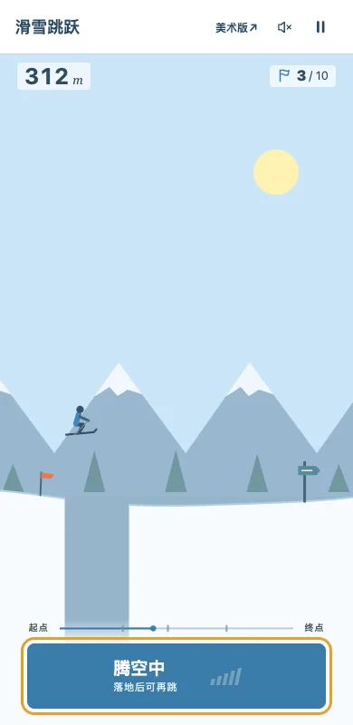
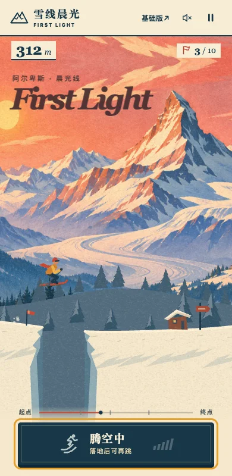

# Indie Game Art · 独立游戏美术

[English](README.md) · **简体中文** · [日本語](README.ja.md)

这个 Codex Skill 帮你打磨已经能玩的游戏。从玩家的一次操作出发，决定美术细节该放在哪里、哪个物件应该动，以及缩到手机上一格还能不能看清。

[玩美食消消乐](https://indie-game-art-biscuits.vercel.app/kissaten/) · [玩肉鸽塔防](https://indie-game-art-biscuits.vercel.app/watch/lantern/?lang=zh) · [玩雪线晨光](https://indie-game-art-biscuits.vercel.app/ski/alpenglow/) · [安装方法](#安装)

## 美术工作台

同一个港口画三次：清晨、风暴将至、雨过天晴。保留送件员和渡船，改远岸屋顶消失在哪里、人物周围留下多少水面、潮湿码头哪一条边反光。再让这些选择延续到一枚按钮、角色的一个动作和最后的告别。


[画风与气氛工作手册](references/look-development.md) · [艺术家与工作室的一手案例](references/source-notebook.md) · [原创气氛稿与可编辑图例](assets/studies/README.md)

具体打磨时可以只读一处：[角色与材质](references/visual-production.md)、[交互表面](references/control-craft.md)、[姿势、特效与环境节奏](references/motion-and-mix.md)，或[从最后一个可玩画面走到胜负结算](references/scene-handoffs.md)。用[带示例的研究表](assets/study-sheet.md)记下借鉴了什么，以及实际效果怎样。

## 01 · 同一份午餐订单，两家店怎么出餐？

**蛋包饭消掉的那一刻，看一眼订单。** 两版的「午间双人餐」都是同样的开局，14 步要收齐 4 份蛋包饭和 4 份三明治。按提示交换同一对餐点，基础版的订单计数增加；在小满洋食屋，还能看见一份蛋包饭从托盘飞到对应的小票上。


[试玩基础版](https://indie-game-art-biscuits.vercel.app/classic/) · [试玩小满洋食屋](https://indie-game-art-biscuits.vercel.app/kissaten/)

## 02 · 当城墙只剩一个位置，召唤还是合成？

《灯港小队》是一局能用拇指玩的合成守城。银币可以买一位随机守卫，也可以买一次三选一强化。两位同类同星守卫能合成，留下高一星的守卫并腾出一个位置。敌人会从海面向下进攻，最后一波由旗舰领队压阵。

动图里两版花的钱、抽到的守卫和来袭的敌人都相同。基础版用几何图形标示职业；港口版里，鱼叉獭的斜长矛、企鹅的冰晶和螃蟹的粗炮管让人能认出合成对象。**试试连续召唤四次，把两位炮手蟹拖到一起，再用空位召唤。**


[试玩基础版](https://indie-game-art-biscuits.vercel.app/watch/classic/?lang=zh) · [试玩灯港小队](https://indie-game-art-biscuits.vercel.app/watch/lantern/?lang=zh) · [玩法与源码](examples/night-watch/)

两组动图都录自可玩的游戏。塔防两版共用战斗模拟，并分别用固定随机序列控制召唤、敌人和强化。

## 03 · 312 米处，同一次起跳

两张图定格在第四道雪沟上方，滑行速度和松手时刻完全相同。《雪线晨光》里，屈起的膝盖和向后飞的红围巾，让人一眼就能从远山前认出滑雪者的姿势。按住屏幕蓄力，在红旗旁松手。落地时留意雪板后扬起的那一小撮雪粉。

| [试玩基础版](https://indie-game-art-biscuits.vercel.app/ski/classic/) | [试玩《雪线晨光》](https://indie-game-art-biscuits.vercel.app/ski/alpenglow/) |
| --- | --- |
|  |  |

[查看共用的雪道、跳跃代码和美术素材](examples/ski/)

## 安装

```sh
npx skills add hanszcy/indie-game-art --skill indie-game-art
```

也可以直接装进 Codex：

```sh
git clone https://github.com/hanszcy/indie-game-art.git ~/.codex/skills/indie-game-art
```

打开自己的游戏项目，先交给它一个具体的动作：

> 用 $indie-game-art 打磨一座防御塔开火的反馈。保持地图、射程和伤害不变。在手机尺寸下看清瞄准、发射和命中，再用一波密集敌人验收。

[中文使用指南](docs/guide.zh-CN.md) · [Skill 原文](SKILL.md) · [六个参考案例](references/research-and-direction.md) · [美术约定模板](assets/visual-contract.md) · [猫鼠游戏复盘](references/session-lessons.md)
