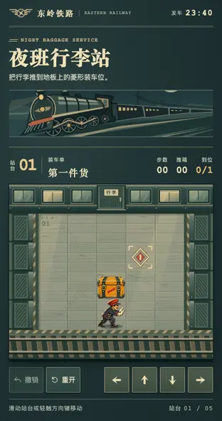
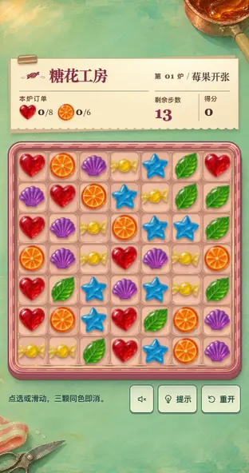

# Indie Game Art · 独立游戏美术

[English](README.md) · **简体中文** · [日本語](README.ja.md)

**Indie Game Art 帮你把游戏原型里的占位图、默认按钮和生硬的动作，改成一套画风一致、能在原项目里试玩的美术和动效。**

| 你遇到的问题 | 你能拿到什么 |
| --- | --- |
| 玩法已经能跑，还没做美术 | 从一个可玩的场景定画风，再把占位图换成第一套角色、背景和操作按钮。你可以直接进游戏，看它们放在一起是什么样。 |
| 已经有美术，界面看起来还是像网页 | 重做玩家最常用的一屏。按游玩时需要看什么、点什么来安排信息，让按钮、图标和面板用上游戏世界里的造型与材质。 |
| 静态画面已经满意，操作起来却缺少动效 | 把动效接到玩家的操作上。按下按钮时立刻有回应，角色命中时有短促的停顿，胜利时给最后一个动作多留一拍。 |

## 实机对照与试玩

[进入试玩页](https://hanszcy.github.io/indie-game-art/play/?lang=zh)

### 推箱子

| [试玩基础版](https://hanszcy.github.io/indie-game-art/play/sokoban/baseline/) | [试玩 Skill 版](https://hanszcy.github.io/indie-game-art/play/sokoban/skill/) |
| :---: | :---: |
| [](https://hanszcy.github.io/indie-game-art/play/sokoban/baseline/) | [](https://hanszcy.github.io/indie-game-art/play/sokoban/skill/) |

### 美食消消乐

| [试玩基础版](https://hanszcy.github.io/indie-game-art/play/match/baseline/) | [试玩 Skill 版](https://hanszcy.github.io/indie-game-art/play/match/skill/) |
| :---: | :---: |
| [](https://hanszcy.github.io/indie-game-art/play/match/baseline/) | [](https://hanszcy.github.io/indie-game-art/play/match/skill/) |

### 滑雪大冒险

| [试玩基础版](https://hanszcy.github.io/indie-game-art/play/ski/baseline/) | [试玩 Skill 版](https://hanszcy.github.io/indie-game-art/play/ski/skill/) |
| :---: | :---: |
| [](https://hanszcy.github.io/indie-game-art/play/ski/baseline/) | [](https://hanszcy.github.io/indie-game-art/play/ski/skill/) |

## 安装

```sh
npx skills add hanszcy/indie-game-art --skill indie-game-art
```

手动安装时，把 [indie-game-art 文件夹](skills/indie-game-art)复制到开发工具的技能目录即可。入口是 [SKILL.md](skills/indie-game-art/SKILL.md)。
