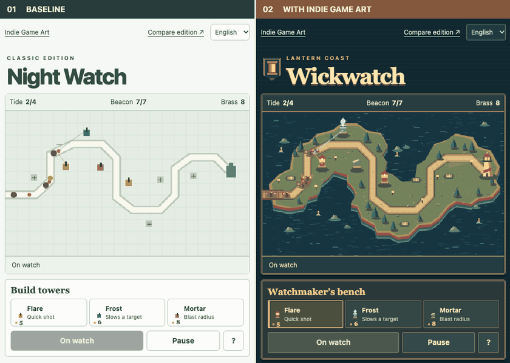

# Indie Game Art · 独立游戏美术

[English](README.md) · **简体中文** · [日本語](README.ja.md)

这个 Codex Skill 帮你打磨已经能玩的游戏。从玩家的一次操作出发，决定美术细节该放在哪里、哪个物件应该动，以及缩到手机上一格还能不能看清。

[玩美食消消乐](https://indie-game-art-biscuits.vercel.app/kissaten/) · [玩肉鸽塔防](https://indie-game-art-biscuits.vercel.app/watch/lantern/?lang=zh) · [安装方法](#安装)

## 01 · 同一份午餐订单，两家店怎么出餐？

**蛋包饭消掉的那一刻，看一眼订单。** 两版的「午间双人餐」都是同样的开局，14 步要收齐 4 份蛋包饭和 4 份三明治。按提示交换同一对餐点，基础版的订单计数增加；在小满洋食屋，还能看见一份蛋包饭从托盘飞到对应的小票上。


[试玩基础版](https://indie-game-art-biscuits.vercel.app/classic/) · [试玩小满洋食屋](https://indie-game-art-biscuits.vercel.app/kissaten/)

## 02 · 同一波敌人，守住灯港

**第一眼能看出是哪座塔开火了吗？** 基础版用线路图和色块表示塔位。到了《灯港守夜》，火花塔是一盏暖黄的灯，霜灯塔顶着细高的晶体，迫击塔有一根低矮的粗炮管。沿弹道看过去，命中位置会闪一下。可以先在前段转弯附近放座迫击塔，再点「迎接潮汐」。



[试玩基础版](https://indie-game-art-biscuits.vercel.app/watch/classic/?lang=zh) · [试玩灯港守夜](https://indie-game-art-biscuits.vercel.app/watch/lantern/?lang=zh) · [查看可运行源码](examples/night-watch/)

每组对照都共享规则和开局。两版塔防还共用固定步长的模拟逻辑，相同局次和选择会抽到相同的遗物。两种美术方案均经过人工取舍，动图录自实际可玩的页面。

## 安装

```sh
npx skills add hanszcy/indie-game-art --skill indie-game-art
```

也可以直接装进 Codex：

```sh
git clone https://github.com/hanszcy/indie-game-art.git ~/.codex/skills/indie-game-art
```

打开自己的游戏项目，先交给它一个具体的动作：

> 用 $indie-game-art 打磨一座防御塔开火的反馈。保持地图、射程和伤害不变。在手机尺寸下看清瞄准、发射和命中，再用一波密集敌人验收。

[中文使用指南](docs/guide.zh-CN.md) · [Skill 原文](SKILL.md) · [六个参考案例](references/research-and-direction.md) · [美术约定模板](assets/visual-contract.md) · [猫鼠游戏复盘](references/session-lessons.md)
