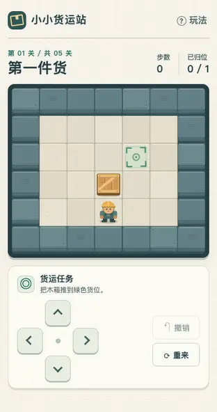
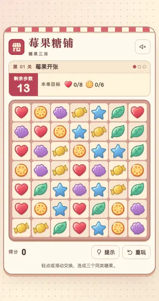
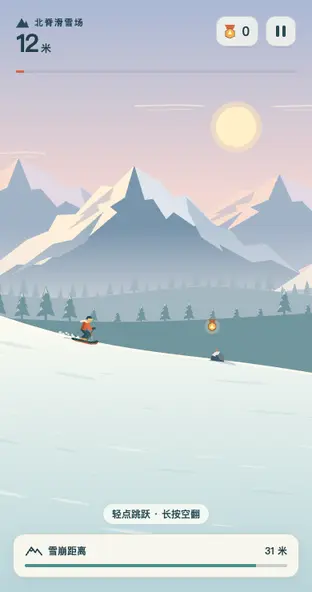
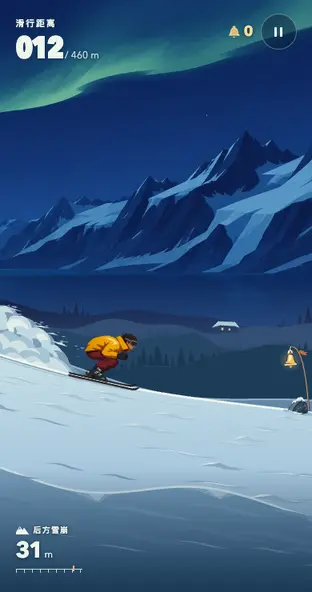

# Indie Game Art · 独立游戏美术

[English](README.md) · **简体中文** · [日本語](README.ja.md)

Indie Game Art v3 从游戏里的一个具体瞬间入手，打磨角色的造型、屏幕上的文字和操作后的反应。

| 游玩时遇到的问题 | 可以怎么改 |
| --- | --- |
| 还在用占位图，或画面缺少辨识度 | 在同一场景里给同一个角色画两种造型，缩到游戏里的实际大小，比一比轮廓和姿态。[一只鹭的两种画法](skills/indie-game-art/plates/bird-study.svg) |
| 台词生硬，提示又啰嗦 | 把台词和同屏提示连起来读。删掉重复的信息，再听听角色的口吻，看玩家是否还清楚自己能怎么选。 |
| 操作界面像网页 | 试着让玩家直接操作画面里的物件。需要比较的信息仍然并排放。 |
| 平时操作和收尾都一个样 | 对照普通的一步和决定胜负的一步。看哪里先动、哪里撑住不动，最后停在什么姿势。 |

## Skill 2.1 版实机对照与试玩

[进入试玩页](https://hanszcy.github.io/indie-game-art/play/?lang=zh)

### 推箱子

| [试玩基础版](https://hanszcy.github.io/indie-game-art/play/sokoban/baseline/) | [试玩 Skill 版](https://hanszcy.github.io/indie-game-art/play/sokoban/skill/) |
| :---: | :---: |
| [](https://hanszcy.github.io/indie-game-art/play/sokoban/baseline/) | [](https://hanszcy.github.io/indie-game-art/play/sokoban/skill/) |

### 美食消消乐

| [试玩基础版](https://hanszcy.github.io/indie-game-art/play/match/baseline/) | [试玩 Skill 版](https://hanszcy.github.io/indie-game-art/play/match/skill/) |
| :---: | :---: |
| [](https://hanszcy.github.io/indie-game-art/play/match/baseline/) | [](https://hanszcy.github.io/indie-game-art/play/match/skill/) |

### 滑雪大冒险

| [试玩基础版](https://hanszcy.github.io/indie-game-art/play/ski/baseline/) | [试玩 Skill 版](https://hanszcy.github.io/indie-game-art/play/ski/skill/) |
| :---: | :---: |
| [](https://hanszcy.github.io/indie-game-art/play/ski/baseline/) | [](https://hanszcy.github.io/indie-game-art/play/ski/skill/) |

## 安装

```sh
npx skills add hanszcy/indie-game-art --skill indie-game-art
```

手动安装时，把 [indie-game-art 文件夹](skills/indie-game-art)复制到开发工具的技能目录。[技能入口](skills/indie-game-art/SKILL.md) · [中文指南](docs/guide.zh-CN.md)
