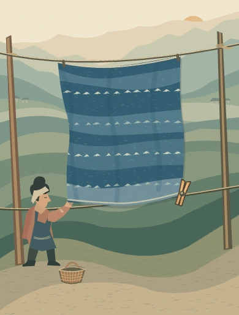
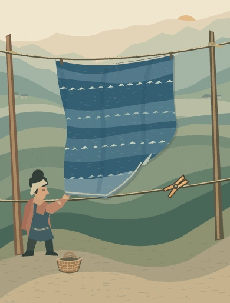

# Field study · Wind in a dye yard

A fresh skill user received a portrait-game brief. Tap a wooden peg to secure a corner of hand-dyed cloth. The existing game decides whether it holds or slips. The workshop should feel quiet in the wind. Only the brief was supplied. The trial produced a small interaction that could receive either outcome from a host game. These are original captures of its drawing surface, taken after a tap with reduced motion enabled.

| The corner holds | The corner slips |
| --- | --- |
|  |  |

**One choice about atmosphere.** The first landscape study etched diagonal marks into the far ridge. At phone size those marks and the upper rope occupied the same space. The artist kept the camera and peg fixed, grouped the distant hills into broad values and put the lively edges into the dyed cloth. The left post and the dyer's supporting hand provide still references for the moving right hem.

**One choice about feedback.** Follow the pale stitching along the lower edge in both pictures. In one it leads to the peg. In the other it turns upwards, exposing hillside where fabric used to be. The jaws change angle at the same point. This is where to spend the drawing effort when a sliding corner matters to the rule. A refusal to accept input would be a different event and should preserve the last confirmed attachment.

**What the interaction established.** The fixture alternated two supplied outcomes. In integration mode a tap forwarded the request once and the drawing waited for the supplied result. Rapid successive results settled on the last reported state. Chrome touch emulation at 320 × 568 CSS pixels kept the scene in view with a 58 × 65 peg target. Space and Enter also activated the peg. The designer could inspect the contact and gap without sound, text or a moving camera. The checks did not measure recognition by players or finger occlusion on a physical phone.

**The next useful playtest.** Cover the caption. Show just the two settled pictures in a random order and ask someone to point to the loose corner. Then run the action on a phone under their thumb. If the pictures read but the action does not, try prolonging the hem's separation or carrying it farther outside the finger's footprint. Keep the target and the existing judge fixed. This question remains open.
