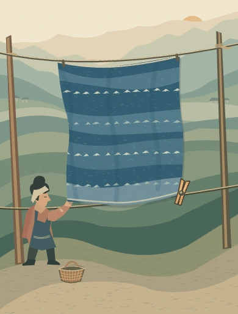
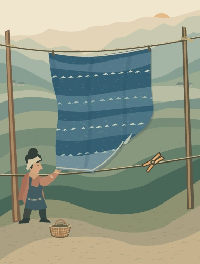

# Score the action

Watch one ordinary action at full speed with the game's normal scene, sound and input. Find the moment of desire, the first acknowledgment the player can perceive, the event that changes game state, and the time when control is available again. Those moments sometimes coincide. For online play, an acknowledged request can precede an outcome by quite a while.

## Draw the performance before decorating it

Choose the body, instrument, word or patch of ground that actually experiences the event. Draw its telling pose just before contact, at contact and after it settles. What stays planted? Where does stored energy go? A snapped thread releases at a particular end. A drawbridge can seem heavy because its chain goes taut while its deck barely moves. In a conversation, someone letting go of a cup can carry more weight than a cut to their face. For graphic or audio-led games, a change in line spacing, phase or a held silence can play the lead.

Look at these original reduced-motion captures of the same cloth. The stitching meets the closed peg in one frame. In the other, the corner folds away and hillside shows through. Trace that gap at the intended size. The peg and the cloth agree on what happened even when the viewer misses the instant of release.

| Secured | Slipped |
| --- | --- |
|  |  |

Set secondary effects to depart from the point of change and decay as attention moves on. A low sound can describe a cavity. Dust can describe a direction. A camera impulse can describe scale, but costs the player a stable point of reference. Give each channel a different job. If several channels say the same thing at the same strength, remove one and listen again. Preserve strong, intentionally overwhelming passages when that loss of composure belongs to the game. Recover the next required read in time.

## Keep the feedback truthful

| Event | What the audience can safely learn | A useful hard case |
| --- | --- | --- |
| Input, aim or selection | A local pose, a physical press, an outline at the destination under consideration | Change target mid-gesture. The old target should no longer look chosen. |
| Pending or interrupted | The request has been heard. The result remains open. Keep the last confirmed state available. | Delay a reply, cancel or pause. A loop must have a clear exit even if success never arrives. |
| Confirmed consequence | Show the affected thing and what changed. Tie sound and pose to that event. Keep a settled sign if it affects a later decision. | Try the opposite outcome and rapid repeats. Do repeated events blend into an invented, larger result? |
| Event witnessed by others | Give each viewpoint the facts that actor can know. Design the witness's reaction separately from the participant's close-up. | An offscreen cue, vibration or directional sound can disclose a secret as surely as a marker. Check the listener's version. |

Spend time in proportion to frequency and emotion. An everyday action needs to survive repetition. An exceptional discovery may deserve a long hold even after the player can act again. Let the end of an animation and the return of input be independent where the game's rules allow. A client effect should follow the same actor position, event and camera transform as any dependent indicator.

When old evidence remains during a new request, give history and live activity separate visual identities. A previous reading might have a stable position, a date, or a different line treatment. Keep it readable for comparisons. Inspect the transition from one confirmed result into the opposite result with a long wait in between. Someone returning mid-wait should be able to tell which event has happened and which one is still open.

## Give the whole scene a tempo

Decide what marks the pulse and where the player can rest. A room can seem alive through a single recurring action with stretches of stillness. A busy arcade can have overlapping rhythms. Give the cycles different sources and let some stop completely. A constant bob, glow and sparkle on every element makes it hard to feel an entrance.

In *Ape Out*, Gabe Cuzzillo describes the choice of an adaptive drum system and its connection to improvisation. It suggests an editorial question for any medium. Which part of the score or image can the player change through play, and what should continue independently? Try two equally loud versions of a sequence, one with a continuous accent and one that leaves space for the player's intervention. Judge at normal speed with the whole mix. [Creator interview on Ape Out's adaptive score](https://nygamecritics.com/2019/04/16/the-circle-interview-creator-gabe-cuzzillo-on-how-ape-out-changed-during-5-years-of-development/)

Tune a deliberate pause by watching what fills it. Try the same event with a shorter and a longer hold while the input acknowledgment stays the same. Someone taking a breath to read, looking back at a character or lingering on a completed work can be the payoff. A second press to see whether the first registered points to a missing acknowledgment or an overlong hold. In shared play, a private confirmation can let one participant relax without giving away their choice. Let the person playing set the reading pace when the scene permits it.

Advance frame by frame to diagnose contact or alignment. Use normal play for weight and rhythm. Try an immediate repeat, a long hold, a quiet interval and an interruption on a supported device. Mute the mix, then reduce motion. Replace a missing cue with an equivalent persistent shape, caption, localized sound or haptic as the medium permits. Preserve expressive sound and animation in the ordinary presentation. Report what required a build, headphones, real hardware or a human timing judgment.
