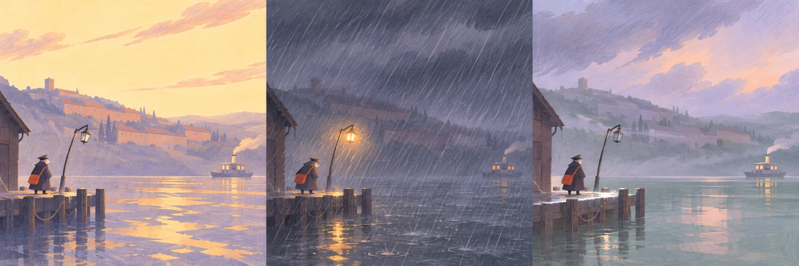

# Direct the image

## Decide where someone would want to look twice

Choose a picture that gives the player a particular relationship to the world. A low ceiling with one distant opening gives the journey a destination. A bird's-eye view of the same room can make its network of paths fascinating. If the camera is fixed by the rules, get the difference from overlap, relative scale, pools of light, the crop or what extends beyond the frame. For an abstract game, rhythm, symmetry and the one piece that breaks the pattern can supply the entire subject.

Sketch the same action with the same character size twice. In one drawing give the surroundings the largest shape. In the other, give that shape to the actor or to the space between actors. Reduce both to thumbnail size. Point to something worth keeping even in the rejected drawing. “I can read this, but it feels like a parade and the scene is about waiting alone” is a reason to redraw. More legibility alone cannot settle an emotional choice.

These three original color keys keep the harbor recognizable across different conditions. Cover the sky in each. How much of the weather survives in the water, the distant shore and the nearest figure? A color pass that lives only in an overlay will be costly to sustain when the camera goes indoors.

## Direct shape, light and color as a group

- **Silhouette and interval.** Draw the actor and their closest lookalike as solid shapes. Change where mass sits, the angle of a held object, the break between limbs or the shape of negative space. Try the pose partly behind scenery. For a cast that should feel related, preserve one family trait and vary a structural trait. Small accessories and hue swaps do little when an actor occupies a few pixels.
- **Depth and edges.** Group distant masses before drawing their contents. A hard edge can show where a hand grips soft fabric. A lost edge can join two figures in shadow. Pick where the contour disappears and where it returns. Giving every object a bright rim flattens the distance between them.
- **Light as staging.** Put the key light where the player encounters the subject. Draw where reflected light would gather and where contact closes it off. Reserve a plausible dark, quiet area in the adjoining frame. In *INSIDE*, Playdead placed bounce, rim and other lighting effects by hand. Its corridor breakdown shows how local adjustments support one physical light. Try moving just one patch of reflected light and see which surface the player now understands. [Playdead's lighting breakdown](https://blog.playdead.com/articles/the_lighting_of_inside/lighting_of_inside.html)
- **Palette as a set of relationships.** Give a family of values to the dominant mass. Decide which hues can touch without losing a boundary and which scarce accent is worth spending on a story detail or state. In *Shovel Knight*, an extra beige solved a particular wool cloak, while a brown expanded the complexions available for portraits. A palette earns an exception when you can point at the person or material it fails. Remove the exception again and inspect what disappears. [Yacht Club Games on its palette](https://www.yachtclubgames.com/blog/breaking-the-nes/)
- **Density and place.** Choose the part of the world a resident would have worn, repaired or cared for. A polished patch on a brass rail tells you where a hand reaches. Put scratches near the reach and let the rest be quiet. In a sterile, abandoned or deliberately abstract world, pristine repetition can be the detail worth preserving. A distress texture across every surface makes them share a history they never had.

## Find a mark worth repeating

Look outside games for something this particular maker or character would notice. A penciled rehearsal score has finger-smudged turns. An engraved map cuts a line of varying thickness through a field of repeated marks. Borrow one property you can actually draw. Try it on a person, a surface and an unheroic detail. When the three start to look like the work of the same hand, decide which objects deserve to break the pattern. Literal paper, grime and outlines are all optional.

Decide which pleasures the frame must protect. In *Hidden Folks*, crowds of hand-drawn figures and scenery reward poking around. Brush can open and a tent flap can hide someone. Removing enough detail to expose the target on first glance would spoil the search. For a similarly dense scene, draw clusters with distinctive silhouettes and quiet seams between them. Let someone scan a region, inspect it up close and find their place again. In a split-second decision, the same density near an urgent cue might be costly. [Adriaan de Jongh and Sylvain Tegroeg on Hidden Folks](https://hiddenfolks.com/)

## Give the material a behavior

For an important surface, draw its edge in light, its edge in shade and the place it meets another material. Folded paper casts a narrow shadow along a crease. Satin changes its highlight across a bent form. Neither requires photographic detail. In pixel art choose the few clusters that survive the render scale. In 3D judge roughness, specular response and edges in motion. In a flat graphic world, an overlap or a broken contour can do the same work.

Two low-resolution games illuminate a choice. In *A Short Hike*, Robinson-Yu used flat shading and soft outlines to make low-resolution 3D forms read. In *Return of the Obra Dinn*, Pope found that a dithered surface that read when still could swim under camera movement. When testing a graphic treatment, turn the camera slowly, stop, then change zoom. If a pattern seems glued to the lens, anchor it to the surface, change its spatial frequency or draw it only where it describes the form. For a world viewed through an actual display, a lens-bound mark may be exactly the intended effect. [A Short Hike development account](https://blog.playstation.com/2021/08/05/crafting-a-tiny-open-world-a-look-behind-the-scenes-at-the-creation-of-a-short-hike/) · [Lucas Pope's moving dither comparisons](https://dukope.com/devlogs/obra-dinn/tig-32/)

## Build a family a small team can sustain

Before producing a cast or an environment set, finish neighboring assets at their common camera and size. Include a plain object. It reveals whether the style has anything to say without an elaborate subject. Fix only the agreements that matter in that game, such as the underside shadow, shadow color, pixel grid, contour endings, viewing angle, pivot or which surfaces catch light. Leave room for one-off hero shapes and asymmetric poses.

Choose the medium by the job. Key art can establish a world. A reusable sprite needs a clean silhouette, contact point and room to animate. Exact geometry may suit a diagram that changes every turn. For generated, drawn or modeled assets, integrate a small batch early. Inspect the cast together on both the lightest and darkest playable backgrounds, including occlusion, transparent fringes and the smallest shipped crop. Keep the editable master or generation source where the team can revise a single pose without redoing the family.
