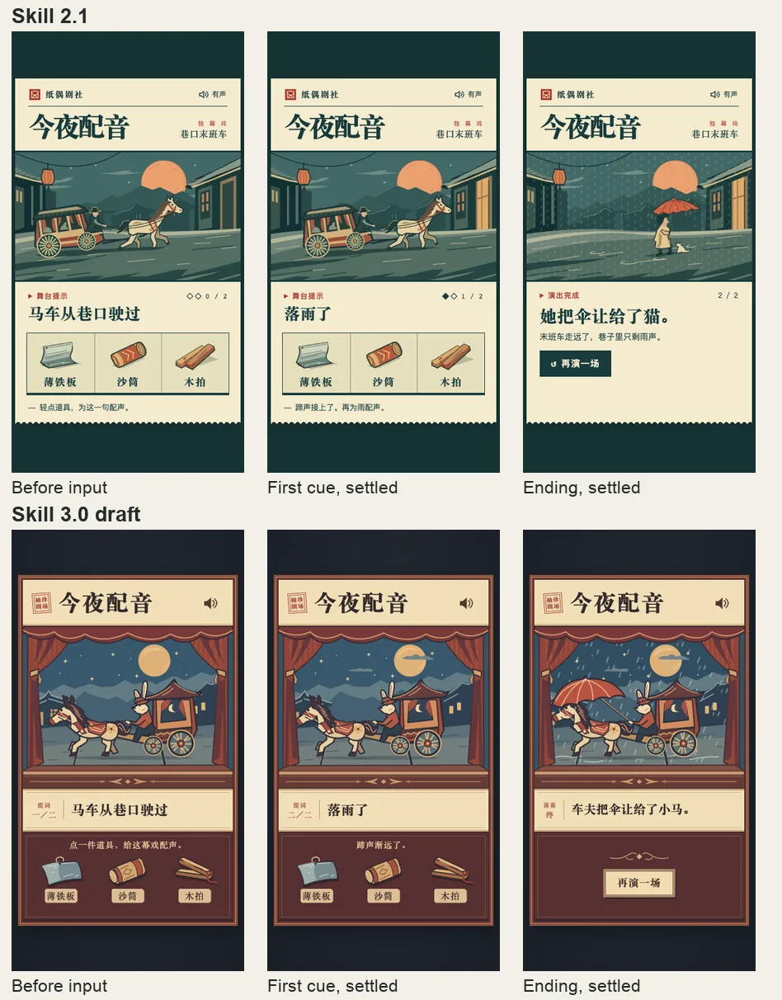

# What changed after a failed art review

The previous gallery was made with version 2.1. A player compared our mobile result screen with a commercial game's in-play screen and found the art generic, the writing stiff, the controls web-like and the action unsatisfying. These states support observations about composition and visible words. To evaluate motion we went back to our own playable recording.

## Why the earlier skill accepted it

- The candidate compositions tested two containers with temporary pieces. They could settle the question of framing while leaving the repeated subject unexamined. The final assets were individually distinguishable, yet my eye kept finding the same small, hard glint across the entire field.
- Three visible messages announced the same delivery. The posted goal, result card and footer each made sense to the person implementing it. Nobody read the whole settled screen as a player. When the card came up it covered the place where the final action happened.
- In the ordinary-action recording, a fissure appeared around 238 ms, four pieces separated around 342 ms and the cavity opened around 440 ms. The action was technically staged. Different subjects still fractured in much the same way. A successful interaction test could verify the state and miss the artistic problem.

Version 3 moves the decision about the subject, the words present in one instant and the difference between an ordinary and exceptional action into the main instructions. Its [notes on the original works and public art skills](../skills/indie-game-art/references/field-notes.md) identify what to borrow from a specific maker and when that choice could make a different game worse.

## A trial on unfamiliar material

Two fresh agent contexts received the same working phone prototype in Chinese. The player picks one of three Foley instruments for a passing carriage and for rain, with a wrong answer, an ending and an encore. Both agents received the same brief and selectors. Each could make one self-contained HTML scene with original art and animation, without outside assets or generators. One received the archived 2.1 skill and one the new draft. They worked separately. Time spent and model variation were uncontrolled.

The comparison used ordinary taps in muted Chrome at 390 × 740 and at 320 × 568 with reduced motion. A wrong choice preserved the cue, two correct choices reached the ending, and encore restored the opening in both. A separate agent played both builds labeled only M and Q, before learning which had which instructions. The judgments below are editorial observations from that review.

| What the reviewer kept | What they would still change |
| --- | --- |
| In the new draft the wooden clapper opens into two parts and closes when struck. A wrong choice gives the iron sheet a rumble in the Chinese line. The instruments read as things the player can perform with. | The older presentation makes the tap regions more immediately obvious. The bench in the new drawing needs to preserve that certainty. |
| The older carriage rolls toward a lit doorway, giving the first sound a destination. The new rabbit driver and horse are distinctive at rest. | In the new draft the horse only shifts a short distance at phone scale. A cloud crossing the moon attracts more attention than the action the player just triggered. |
| The old theatre leaves a person and cat in the empty street. The new theatre keeps the rabbit and horse from the opening and opens an umbrella over the horse. Both are readable endings with different pleasures. | The reviewer could see the rabbit shelter the horse but questioned wording that suggests handing over the umbrella. The driver's hand still holds it. The older ending also relies on a small, easily missed beneficiary. |

This prompted two edits to the instructions. In the ordinary-action review, cover the changing words, freeze incidental scenery and identify the relationship the player changed. In the writing review, read the verb against the visible pose and the person who receives the action.

A follow-up editor received the revised ordinary-action passage and the new draft. On the same camera, the horse now travels past a lit window and the carriage uncovers two more. The starting curtain crops part of the rear wheel to make room. The rules and umbrella finale are intact. This was a directed second pass with extra work, separate from the blinded comparison. In a second, unblinded viewing with words hidden and sound off, the reviewer could see the carriage move roughly 60 screen pixels past the window, versus about 15 in the draft. The opening loses the full wheel silhouette. [Play the two ordinary actions side by side](ordinary-action.webp).

One short prototype and one agent reviewer can expose where the instructions fail. They do not measure player preference, show that the method travels to every genre, or establish what another artist would make with the same time.
